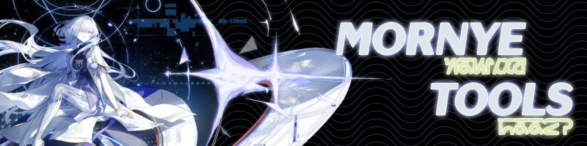

  

Desktop companion for Wuthering Waves. It reads the game's own network traffic to
keep your account data live, rates your echoes, and follows along in an overlay
while you upgrade them.

## Download

<table>
  <tr>
    <th colspan="2" align="center">Windows 10/11</th>
    <th colspan="3" align="center">Linux</th>
  </tr>
  <tr>
    <td align="center">
      <a href="https://github.com/Yumeo0/mornye-tools/releases/latest/download/mornye-tools-windows-x86_64-setup.exe">
         
        <b>Installer</b> 
        .exe · x64
      </a>
    </td>
    <td align="center">
      <a href="https://github.com/Yumeo0/mornye-tools/releases/latest/download/mornye-tools-windows-x86_64.msi">
         
        <b>MSI package</b> 
        .msi · x64
      </a>
    </td>
    <td align="center">
      <a href="https://github.com/Yumeo0/mornye-tools/releases/latest/download/mornye-tools-linux-x86_64.AppImage">
         
        <b>AppImage</b> 
        portable · x86_64
      </a>
    </td>
    <td align="center">
      <a href="https://github.com/Yumeo0/mornye-tools/releases/latest/download/mornye-tools-linux-x86_64.deb">
         
        <b>.deb</b> 
        Debian · Ubuntu
      </a>
    </td>
    <td align="center">
      <a href="https://github.com/Yumeo0/mornye-tools/releases/latest/download/mornye-tools-linux-x86_64.rpm">
         
        <b>.rpm</b> 
        Fedora · RHEL
      </a>
    </td>
  </tr>
</table>

  <a href="https://github.com/Yumeo0/mornye-tools/releases">
    
    <b>All releases</b>
  </a>

## Features

- **Live account sync** - your profile, resonators, weapons and echoes stay current
  as you play.
- **Characters, Echoes, Weapons** - browse your inventory, with substat ratings,
  lock/discard marks and stack counts (×N) on each echo card.
- **Build calculator** - evaluates a build's damage.
- **Optimizer** - finds the best loadout for a target from your echo inventory.
- **Overlay echo scan** - shows substat value while upgrading the echo in-game.
- **Echo Upgrade Assistant** - re-rates an echo after each upgrade or tuning and marks.
  it for discard once it can no longer reach your threshold.
- **Exploration map** - chests, Tidal Heritage, collectible, quest and
  gathering placements across all maps, with your live progress and a GHZS
  import (WIP) for marks you already have.
- **Achievements** - the client's achievement snapshot and live updates, with
  search, group filters and a hidden-achievement toggle.

## Documentation

- [Development, releases and architecture](docs/DEVELOPMENT.md) - build and test
  commands, how releases are cut and self-updated, the packet-capture internals,
  the exploration-map data pipeline, the overlay protocol and the source layout.

## Support

