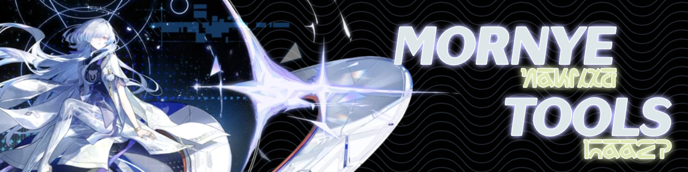

  

Desktop companion for Wuthering Waves. Sync your account from the game's network
traffic, evaluate Echo builds, plan team rotations, optimize damage, and track
exploration. An in-game overlay follows along while you upgrade Echoes.

## Contents

- [Download](#download)
- [Features](#features)
  - [Account and collection](#account-and-collection)
  - [Rotations and optimization](#rotations-and-optimization)
  - [Overlay and progression](#overlay-and-progression)
  - [Optional active tools](#optional-active-tools)
  - [Data and diagnostics](#data-and-diagnostics)
- [Getting started](#getting-started)
- [Documentation](#documentation)
- [Support](#support)

## Download

<table>
  <tr>
    <th colspan="2" align="center">Windows 10/11</th>
    <th colspan="3" align="center">Linux</th>
  </tr>
  <tr>
    <td align="center">
      <a href="https://github.com/Yumeo0/mornye-tools/releases/latest/download/mornye-tools-windows-x86_64-setup.exe">
         
        <b>Installer</b> 
        .exe · x64
      </a>
    </td>
    <td align="center">
      <a href="https://github.com/Yumeo0/mornye-tools/releases/latest/download/mornye-tools-windows-x86_64.msi">
         
        <b>MSI package</b> 
        .msi · x64
      </a>
    </td>
    <td align="center">
      <a href="https://github.com/Yumeo0/mornye-tools/releases/latest/download/mornye-tools-linux-x86_64.AppImage">
         
        <b>AppImage</b> 
        portable · x86_64
      </a>
    </td>
    <td align="center">
      <a href="https://github.com/Yumeo0/mornye-tools/releases/latest/download/mornye-tools-linux-x86_64.deb">
         
        <b>.deb</b> 
        Debian · Ubuntu
      </a>
    </td>
    <td align="center">
      <a href="https://github.com/Yumeo0/mornye-tools/releases/latest/download/mornye-tools-linux-x86_64.rpm">
         
        <b>.rpm</b> 
        Fedora · RHEL
      </a>
    </td>
  </tr>
</table>

## Features

### Account and collection

- **Live account sync** through passive traffic capture, with separate player
  profiles, server information, and an overview of your account and collection.
- **Item inventory** with exact owned counts, search and category filters, plus
  pinned currencies and tides. Check your Shell Credits, tuners and EXP tubes
  before upgrading.
- **Resonator and weapon catalogs** with owned gear, filters, build recommendations,
  and clearly marked previews of supported upcoming content. Resonator details
  include animated portraits, levels, Resonance Chains, equipped gear, and build
  stats such as attributes, damage bonuses and healing.
- **Echo evaluation** with Roll Value (RV) ratings for relevant Resonators,
  highlighted useful substats, and filters for sets, stats, equipment and marks.
  Compare total build RV with its theoretical maximum, or add manual Echoes for
  planning.
- **Saved teams** synced from the game, showing each team's members and active
  status.

### Rotations and optimization

- **Rotation Builder** to create and save team rotations, arrange actions and
  repeated sequences, then simulate playback and inspect errors at the action
  that caused them.
- **Rotation-based optimizer** using pre-made or custom rotations. Compare
  estimated rotation damage, search by team members, and filter for teams you own.
  Choose a Resonator and search your Echo inventory to improve their own damage
  or total team damage, with Energy Regen requirements checked against the rotation.
  Compare results with your current build, including detailed stats and total RV.
  Teammates can use equipped Echoes or the rotation's suggested stats.

### Overlay and progression

- **In-game Echo overlay** that rates the Echo you're viewing, ranks relevant
  Resonators, and highlights preferred stats while you upgrade or tune it.
  The optional **Echo Upgrade Assistant** marks an Echo for discard when no
  relevant build guide can still reach your target RV.
- **Exploration map** with live player tracking, region navigation, collectible
  and quest filters, reward details, and synced collection progress. Add manual
  collected/uncollected marks or import existing GHZS marks.
- **Quest and achievement tracking** with search, category and completion filters,
  progress totals, and expandable quest descriptions.

### Optional active tools

Enable **Dangerous Features** to connect directly to a game account. This opens a
separate session and can disconnect your running game. Read the
[connection guide](docs/DANGEROUS_FEATURES.md) before connecting.

- **Manage Echoes in-game:** lock, mark for discard, or unequip captured Echoes
  from the Echoes tab, and equip optimizer results directly.
- **Edit saved teams:** rename teams, change or reorder members, and switch the
  active team.
- **Bulk Echo upgrades:** select copies to level and tune, set a target RV and
  minimum success chance, and choose allowed fodder and EXP tubes. Each new
  substat is evaluated before spending more; failed Echoes can be marked for
  discard and reused as fodder for later upgrades.

### Data and diagnostics

- **JSON export and restore** for Resonators, weapons, Echoes and map progress,
  with selectable data groups and an import preview.
- **Capture diagnostics and recording** with raw PCAP and decoded JSON exports,
  offline PCAP/PCAPNG import, and OCR diagnostics.
- **Built-in updates** with release notes before installing and after restarting,
  plus a warning when the installed game is newer than the app supports.

## Getting started

1. Start Mornye Tools **before logging into the game**. Run **as Administrator on
   Windows**; Linux capture needs the permissions described in
   [Linux capture setup](docs/DEVELOPMENT.md#capture-and-overlay).
2. Log into the game, then open the Resonator, Echo, weapon, item inventory and
   team setup menus to sync their data. Capturing login also syncs quests and
   achievements. If the game was already running, reconnect or relaunch it while
   Mornye Tools is open.
3. Select your player profile in the sidebar to browse its collection and progress.
   Profile selection changes what you view; an active connection keeps syncing
   the profile it connected to.

- **Plan a build:** open **Optimizer**, load a pre-made rotation or one saved in
  **Rotations**, select a Resonator, and choose own or total team damage.
  The simulation assumptions are available beside the rotation heading.
- **Use the overlay:** enable **Settings → General → Overlay** and set
  **Echo detection → Resolution** to match the game. Keep the game's profile
  selected while viewing its Echoes. Configure the optional discard assistant
  under **Settings → Tools → Echo Upgrade Assistant**.
- **Track exploration:** on **Map**, press **C** to toggle the selected item's
  collected state. Change the shortcut under **Settings → General → Map shortcuts**.
  Import GHZS marks through **Settings → Data → Import map progress → Start import**.
- **Save or restore data:** use **Settings → Data → Export account data** to save
  selected collection and map data, or **Import Mornye JSON** to review and restore
  an export.
- **Use active tools:** enable **Settings → Dangerous Features**, add a player
  profile, select it, then click **Connect** at the bottom left and wait for
  **In world**. Echo controls, team editing, equipping builds and the **Upgrader**
  require a connection to that profile.

## Documentation

- [Development](docs/DEVELOPMENT.md): setup, checks, releases and architecture.
- [Active connections](docs/DANGEROUS_FEATURES.md): login, profiles and echo upgrades.
- [Changelog](CHANGELOG.md): features, improvements and fixes by release.

## Support

